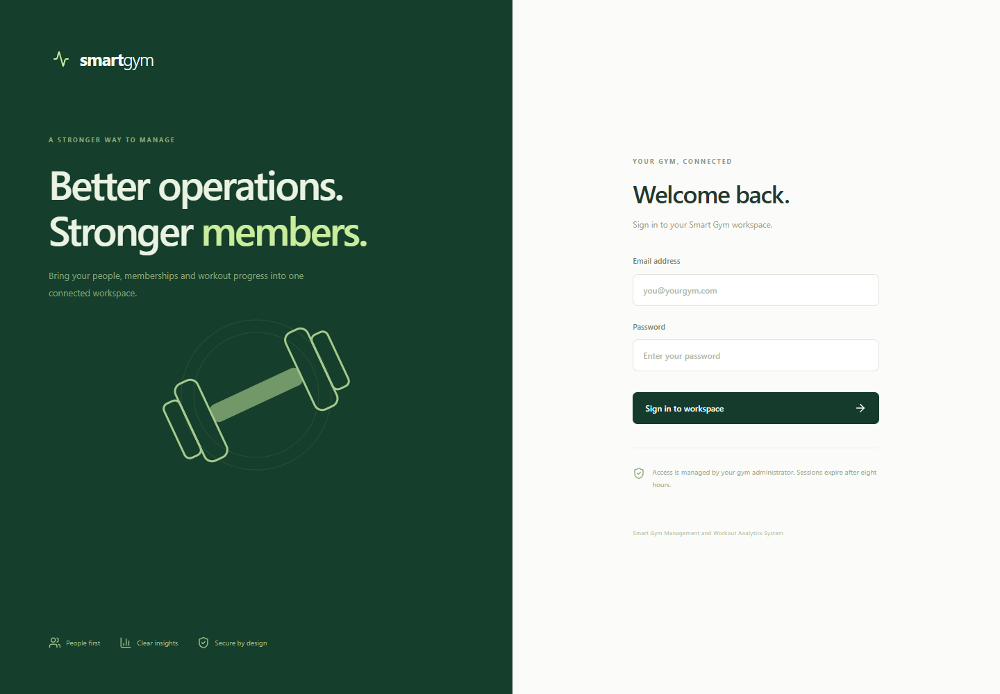
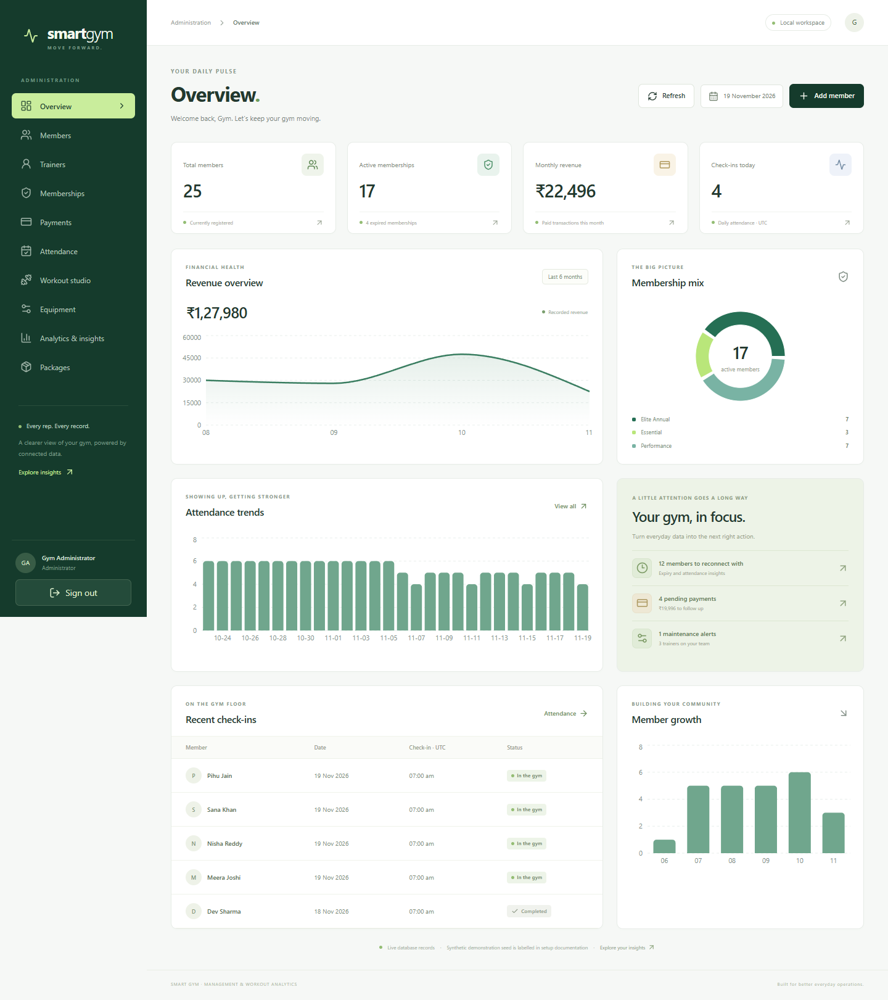
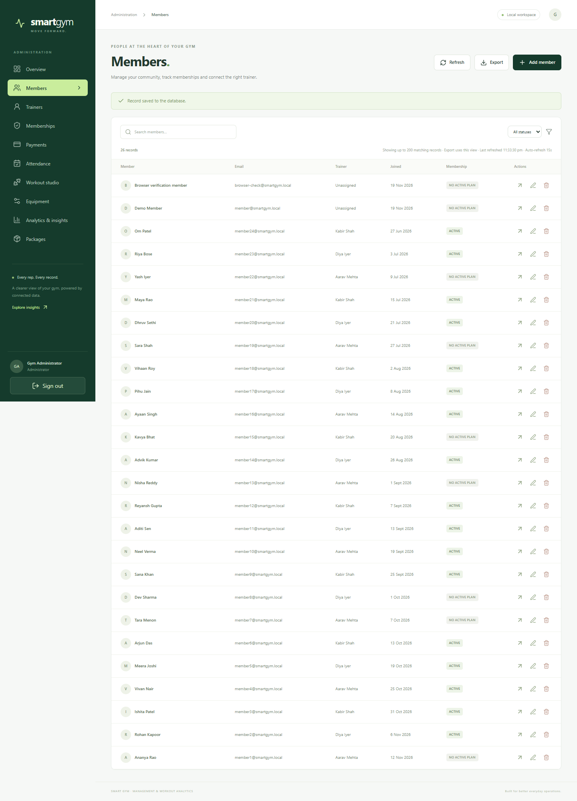
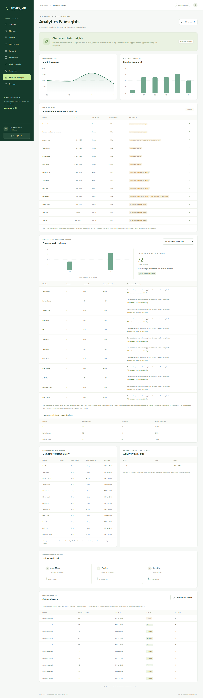
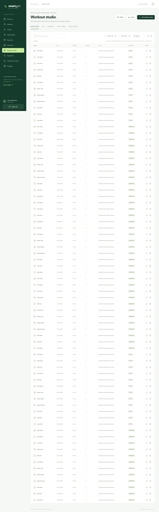

# 🏋️ Smart Gym Management System

**A full-stack gym management application built using Next.js, MySQL, and MongoDB.**

Smart Gym Management System is a database-driven web application designed to simplify gym administration, member management, trainer assignments, workout planning, attendance tracking, payments, and performance monitoring.

The system combines relational and NoSQL databases to support structured gym operations and analytical reporting.

## 🚀 Key Features

- **Role-Based Access:** Separate interfaces and permissions for administrators, trainers, and members.
- **Member Management:** Manage member profiles, memberships, and subscriptions.
- **Trainer Management:** Maintain trainer information and member assignments.
- **Workout Management:** Create and manage workout plans, exercises, and fitness progress.
- **Attendance Tracking:** Record and monitor gym attendance.
- **Payments and Packages:** Manage membership packages, payments, and subscription records.
- **Equipment Management:** Track gym equipment and maintenance.
- **Analytics Dashboard:** View gym statistics, operational insights, and reports.
- **Database Operations:** Demonstrate SQL queries, stored procedures, functions, and MongoDB aggregations.
- **Responsive Interface:** Access the application through desktop and mobile browsers.

## 🛠️ Technology Stack

| Component | Technology |
|---|---|
| Frontend | Next.js, React, TypeScript |
| Styling | CSS |
| Backend | Next.js API Routes |
| Relational Database | MySQL |
| NoSQL Database | MongoDB |
| Database Toolkit | Prisma |
| Development Environment | Visual Studio Code |
| Testing | Automated unit, integration, and browser tests |
| Version Control | Git and GitHub |

## 🗄️ Database Architecture

Smart Gym uses two database technologies:

**MySQL** handles structured and relational information such as members, trainers, workout plans, attendance, subscriptions, and payments.

**MongoDB** supports document-oriented information and aggregation-based reporting.

The project demonstrates important DBMS concepts, including:

- Primary keys and foreign keys
- Relational database design
- SQL joins and subqueries
- Database constraints
- Stored procedures and functions
- Transactions
- MongoDB collections and aggregation pipelines

For additional information, refer to the [Database Design Documentation](smart-gym/docs/DATABASE_DESIGN.md).

## 📸 Application Screenshots

### Login Page



### Admin Dashboard



### Member Management



### Analytics Dashboard



### Workout Management



## 📁 Project Structure

```text
Smart-Gym-Management/
│
├── smart-gym/
│   ├── app/              # Pages and API routes
│   ├── components/       # Reusable UI components
│   ├── database/         # MySQL and MongoDB resources
│   ├── docs/             # Technical documentation
│   ├── lib/              # Application and business logic
│   ├── prisma/           # Prisma database schema
│   ├── scripts/          # Setup and maintenance scripts
│   ├── tests/            # Automated tests
│   └── README.md
│
├── presentation/         # Presentation and demo materials
├── Smart-Gym.code-workspace
├── start.ps1
└── README.md
```

## ⚙️ Installation and Setup

### 1. Clone the Repository

```bash
git clone https://github.com/Koushik504/Smart-Gym-Management.git
cd Smart-Gym-Management
```

### 2. Configure the Databases

Ensure MySQL and MongoDB are installed and running locally.

| Service | Configuration |
|---|---|
| MySQL Host | 127.0.0.1 |
| MySQL Port | 3306 |
| MySQL Database | smart_gym |
| MongoDB Port | 27017 |

Configure the required environment variables in `smart-gym/.env`, using `smart-gym/.env.example` as a reference.

### 3. Install Dependencies

```powershell
cd smart-gym
npm install
cd ..
```

### 4. Start the Application

Run the following command from the repository root in PowerShell:

```powershell
powershell -ExecutionPolicy Bypass -File .\start.ps1
```

Alternatively, from the `smart-gym/` directory:

```powershell
npm.cmd run dev
```

### 5. Open the Application

Visit:

**http://127.0.0.1:3100**

The application requires correctly configured and initialized local databases.

## 🔐 Demonstration Accounts

The project includes local demonstration accounts for testing the application.

| Role | Email |
|---|---|
| Administrator | admin@smartgym.local |
| Member | member@smartgym.local |

Demo credentials and initialization details are documented in the local setup configuration. Existing configured passwords take precedence.

**Security note:** Demonstration credentials must not be used for production deployments.

## 🧪 Testing and Verification

The project includes automated tests and supporting technical evidence.

Testing resources cover application functionality, database operations, API behavior, and browser interactions.

Refer to the [Testing Documentation](smart-gym/docs/TESTING.md) and [Test Results](smart-gym/docs/TEST_RESULTS.json).

## 📚 Documentation

| Resource | Description |
|---|---|
| [Application Guide](smart-gym/README.md) | Application setup and operation |
| [Documentation Index](smart-gym/docs/INDEX.md) | Complete technical documentation |
| [Database Design](smart-gym/docs/DATABASE_DESIGN.md) | Database structure and relationships |
| [ER Diagram](smart-gym/docs/ER_DIAGRAM.mmd) | Entity relationship diagram |
| [API Documentation](smart-gym/docs/API.md) | API endpoints and role permissions |
| [Advanced Database](smart-gym/docs/ADVANCED_DATABASE.md) | Advanced SQL and database features |
| [Project Report](presentation/04_PROJECT_REPORT.md) | Detailed project report |
| [Presentation Guide](presentation/00_START_HERE.md) | Demonstration and viva preparation |

## 🎯 Project Objective

To develop an integrated gym management system that reduces manual administrative work, improves the organization of gym records, and demonstrates the practical application of relational and NoSQL database technologies.

## 👨‍💻 Project Repository

**GitHub:** https://github.com/Koushik504/Smart-Gym-Management

## 📄 Attribution

Original source contributions and third-party acknowledgments are documented in [ATTRIBUTION.md](smart-gym/ATTRIBUTION.md).

---

**Smart Gym Management System — DBMS Mini Project**
