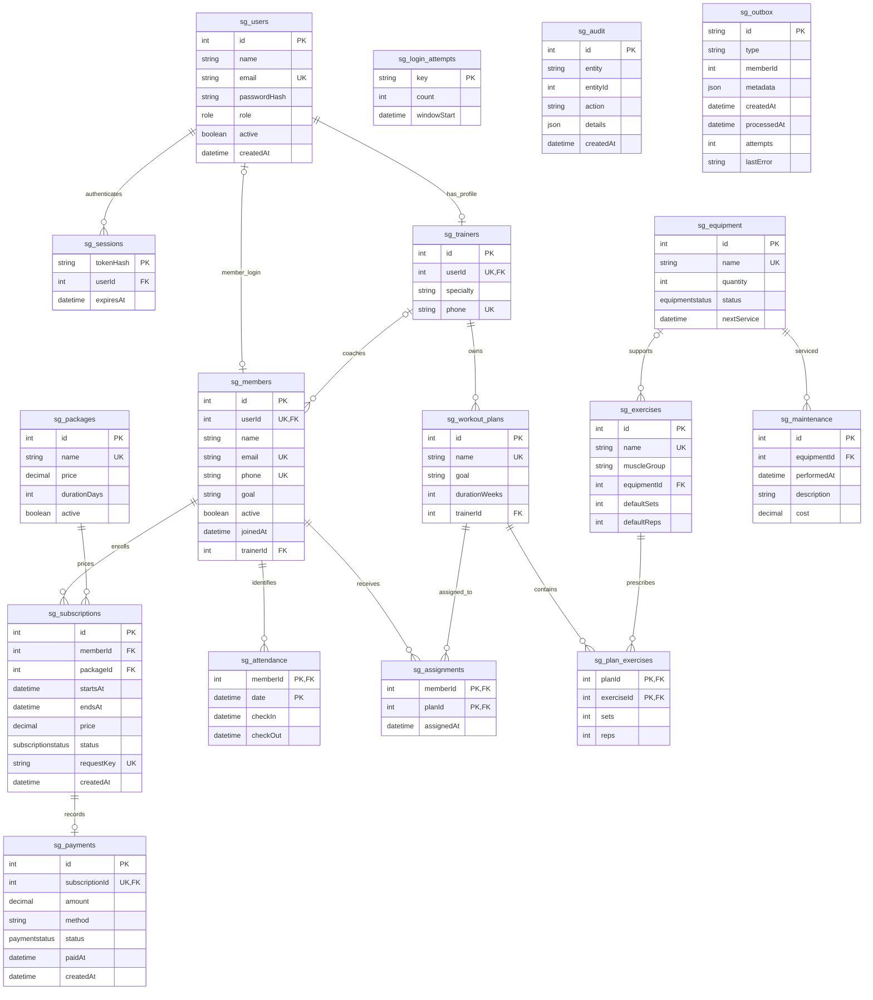

# Database design, relational schema and data dictionary

Canonical source: `prisma/schema.prisma`. Ordered MySQL implementation: `database/mysql/001_schema.sql` (tables), `002_advanced.sql` (constraints/views/triggers/renewal), `003_api_routines.sql` (read-only functions/procedures), `004_member_accounts.sql` (member logins). This dictionary is generated from the current scalar fields. Physical table names use the sg_ prefix. Current database: smart_gym on MySQL port 3306; MongoDB uses port 27017. See [API permissions](API.md) and [verified database move](MYSQL_MOVE_RESULTS.json).

## ER diagram

## Relationships and cardinalities

- A User has zero or one Trainer profile or a linked Member profile. A Member can exist without a login; nullable UNIQUE userId links at most one account to a member, with ON DELETE SET NULL. USER accounts require an active linked member to authenticate. Staff profiles and regular member profiles have separate roles. One User has many Sessions.
- A Trainer coaches zero or many Members; a Member has zero or one current Trainer. A Trainer owns many WorkoutPlans; a plan has one owner.
- A Member has many Subscriptions; each Subscription references one Package. A Subscription has at most one Payment by a UNIQUE FK. The application/procedure creates the payment with the subscription in a single transaction.
- Attendance is a weak entity identified by (memberId, date). It depends on one Member; records restrict deletion to preserve history.
- Members and WorkoutPlans are many-to-many through Assignment. WorkoutPlans and Exercises are many-to-many through PlanExercise, which carries sets and reps.
- Exercise optionally references one Equipment inventory entry; Equipment supports many exercises and has many Maintenance records.
- Audit holds historical entity IDs and JSON snapshots without a cascading FK. Outbox memberId is a durable activity reference, not a cascading FK; activity survives operational changes. LoginAttempt is a security-support table keyed by a hashed email value.
- MongoDB uses the same integer memberId and exerciseId references. These are application-validated references, not cross-engine foreign keys. MongoDB logs/measurements are one-to-many per SQL member.

## Relational schema

**sg_users** (`User`): **id**, name, email, passwordHash, role, active, createdAt.

Primary key: id. No relational foreign key.

**sg_sessions** (`Session`): **tokenHash**, userId, expiresAt.

Primary key: tokenHash. Foreign-key columns: userId.

**sg_login_attempts** (`LoginAttempt`): **key**, count, windowStart.

Primary key: key. No relational foreign key.

**sg_trainers** (`Trainer`): **id**, userId, specialty, phone.

Primary key: id. Foreign-key columns: userId.

**sg_members** (`Member`): **id**, userId, name, email, phone, goal, active, joinedAt, trainerId.

Primary key: id. Foreign-key columns: userId, trainerId.

**sg_packages** (`Package`): **id**, name, price, durationDays, active.

Primary key: id. No relational foreign key.

**sg_subscriptions** (`Subscription`): **id**, memberId, packageId, startsAt, endsAt, price, status, requestKey, createdAt.

Primary key: id. Foreign-key columns: memberId, packageId.

**sg_payments** (`Payment`): **id**, subscriptionId, amount, method, status, paidAt, createdAt.

Primary key: id. Foreign-key columns: subscriptionId.

**sg_attendance** (`Attendance`): **memberId**, **date**, checkIn, checkOut.

Primary key: memberId, date. Foreign-key columns: memberId.

**sg_equipment** (`Equipment`): **id**, name, quantity, status, nextService.

Primary key: id. No relational foreign key.

**sg_maintenance** (`Maintenance`): **id**, equipmentId, performedAt, description, cost.

Primary key: id. Foreign-key columns: equipmentId.

**sg_exercises** (`Exercise`): **id**, name, muscleGroup, equipmentId, defaultSets, defaultReps.

Primary key: id. Foreign-key columns: equipmentId.

**sg_workout_plans** (`WorkoutPlan`): **id**, name, goal, durationWeeks, trainerId.

Primary key: id. Foreign-key columns: trainerId.

**sg_plan_exercises** (`PlanExercise`): **planId**, **exerciseId**, sets, reps.

Primary key: planId, exerciseId. Foreign-key columns: planId, exerciseId.

**sg_assignments** (`Assignment`): **memberId**, **planId**, assignedAt.

Primary key: memberId, planId. Foreign-key columns: memberId, planId.

**sg_audit** (`Audit`): **id**, entity, entityId, action, details, createdAt.

Primary key: id. No relational foreign key.

**sg_outbox** (`Outbox`): **id**, type, memberId, metadata, createdAt, processedAt, attempts, lastError.

Primary key: id. No relational foreign key.

## Normalization

1NF: MySQL columns contain scalar values; variable exercise lists are represented by PlanExercise rows rather than comma-separated IDs. Flexible workout entry arrays intentionally use MongoDB document embedding.
2NF: PlanExercise depends on the complete (planId, exerciseId) key; its sets/reps describe that exact prescription. Attendance fields depend on the complete (memberId, date) key. Assignment time depends on the member-plan pairing.
3NF: User credentials/identity, Trainer specialty, Member contact, Package pricing, Subscription period/history, Payment settlement and Equipment/Maintenance are separated by their functional dependencies. Derived member status, expiry and revenue are queried rather than copied onto Member.
The Subscription price snapshot records a historical agreed fact, not a duplicate of the currently editable package price. Audit and outbox metadata are deliberate historical/event records with different lifecycles. Unique payment.subscriptionId enforces one payment per subscription; completeness of that pair is an application transaction invariant, not an FK guarantee that every direct SQL subscription insert has a payment.

## Full scalar data dictionary

DateTime defaults to MySQL DATETIME(3), Boolean to BOOLEAN/TINYINT(1), Int to INTEGER, Json to JSON. Explicit @db attributes below override defaults. All columns are NOT NULL unless marked optional; optional relationships use nullable FK columns. Prisma relation objects/lists are not extra stored columns.

### sg_users

| Column | Logical / explicit SQL type | Nullable | Constraints/defaults | Meaning |
| --- | --- | --- | --- | --- |
| id | Int | No | `@id @default(autoincrement())` | Stable generated primary identifier |
| name | String | No | `@db.VarChar(150)` | Display name |
| email | String | No | `@unique @db.VarChar(150)` | Unique normalized contact/login email |
| passwordHash | String | No | `@db.VarChar(255)` | bcrypt hash, never plaintext |
| role | Role | No | `—` | Authorization role |
| active | Boolean | No | `@default(true)` | Registration/account/catalog availability flag |
| createdAt | DateTime | No | `@default(now())` | Creation timestamp |

### sg_sessions

| Column | Logical / explicit SQL type | Nullable | Constraints/defaults | Meaning |
| --- | --- | --- | --- | --- |
| tokenHash | String | No | `@id @db.Char(64)` | SHA-256 hash of opaque browser token |
| userId | Int | No | `FK; —` | User account reference |
| expiresAt | DateTime | No | `—` | Session expiry timestamp |

Composite keys/indexes: `@@index([expiresAt])`.

### sg_login_attempts

| Column | Logical / explicit SQL type | Nullable | Constraints/defaults | Meaning |
| --- | --- | --- | --- | --- |
| key | String | No | `@id @db.Char(64)` | SHA-256 normalized email key for throttling |
| count | Int | No | `@default(0)` | Attempt counter |
| windowStart | DateTime | No | `@default(now())` | Start of the 15-minute rate-limit window |

### sg_trainers

| Column | Logical / explicit SQL type | Nullable | Constraints/defaults | Meaning |
| --- | --- | --- | --- | --- |
| id | Int | No | `@id @default(autoincrement())` | Stable generated primary identifier |
| userId | Int | No | `FK; @unique` | User account reference |
| specialty | String | No | `@db.VarChar(120)` | Trainer coaching specialty |
| phone | String | Yes | `@unique @db.VarChar(20)` | Optional unique phone contact |

### sg_members

| Column | Logical / explicit SQL type | Nullable | Constraints/defaults | Meaning |
| --- | --- | --- | --- | --- |
| id | Int | No | `@id @default(autoincrement())` | Stable generated primary identifier |
| userId | Int | Yes | `FK; @unique` | User account reference |
| name | String | No | `@db.VarChar(150)` | Display name |
| email | String | No | `@unique @db.VarChar(150)` | Unique normalized contact/login email |
| phone | String | Yes | `@unique @db.VarChar(20)` | Optional unique phone contact |
| goal | String | No | `@default("General fitness") @db.VarChar(200)` | Fitness/training goal |
| active | Boolean | No | `@default(true)` | Registration/account/catalog availability flag |
| joinedAt | DateTime | No | `@default(now())` | Member registration timestamp |
| trainerId | Int | Yes | `FK; —` | Assigned/owning trainer reference |

Composite keys/indexes: `@@index([trainerId, active])`; `@@index([joinedAt])`.

### sg_packages

| Column | Logical / explicit SQL type | Nullable | Constraints/defaults | Meaning |
| --- | --- | --- | --- | --- |
| id | Int | No | `@id @default(autoincrement())` | Stable generated primary identifier |
| name | String | No | `@unique @db.VarChar(100)` | Display name |
| price | Decimal | No | `@db.Decimal(10,2)` | Agreed or current price in INR; subscription keeps a historical snapshot |
| durationDays | Int | No | `—` | Inclusive membership duration in days |
| active | Boolean | No | `@default(true)` | Registration/account/catalog availability flag |

### sg_subscriptions

| Column | Logical / explicit SQL type | Nullable | Constraints/defaults | Meaning |
| --- | --- | --- | --- | --- |
| id | Int | No | `@id @default(autoincrement())` | Stable generated primary identifier |
| memberId | Int | No | `FK; —` | Stable MySQL member reference |
| packageId | Int | No | `FK; —` | Membership package reference |
| startsAt | DateTime | No | `@db.Date` | First inclusive UTC membership date |
| endsAt | DateTime | No | `@db.Date` | Last inclusive UTC membership date |
| price | Decimal | No | `@db.Decimal(10,2)` | Agreed or current price in INR; subscription keeps a historical snapshot |
| status | SubscriptionStatus | No | `@default(ACTIVE)` | Constrained business state (see enum) |
| requestKey | String | No | `@unique @db.VarChar(64)` | Unique client-generated renewal UUID for duplicate-request protection |
| createdAt | DateTime | No | `@default(now())` | Creation timestamp |

Composite keys/indexes: `@@index([memberId, status, endsAt])`; `@@index([endsAt, status])`.

### sg_payments

| Column | Logical / explicit SQL type | Nullable | Constraints/defaults | Meaning |
| --- | --- | --- | --- | --- |
| id | Int | No | `@id @default(autoincrement())` | Stable generated primary identifier |
| subscriptionId | Int | No | `FK; @unique` | Unique subscription being paid |
| amount | Decimal | No | `@db.Decimal(10,2)` | Recorded agreed payment amount in INR |
| method | String | No | `@db.VarChar(20)` | CASH, CARD, UPI or BANK |
| status | PaymentStatus | No | `@default(PAID)` | Constrained business state (see enum) |
| paidAt | DateTime | Yes | `—` | Settlement timestamp; required exactly when PAID |
| createdAt | DateTime | No | `@default(now())` | Creation timestamp |

Composite keys/indexes: `@@index([status, paidAt])`.

### sg_attendance

| Column | Logical / explicit SQL type | Nullable | Constraints/defaults | Meaning |
| --- | --- | --- | --- | --- |
| memberId | Int | No | `FK; —` | Stable MySQL member reference |
| date | DateTime | No | `@db.Date` | UTC attendance date; weak-entity discriminator |
| checkIn | DateTime | No | `@default(now())` | Check-in timestamp |
| checkOut | DateTime | Yes | `—` | Optional checkout timestamp after check-in |

Composite keys/indexes: `@@id([memberId, date])`; `@@index([date])`.

### sg_equipment

| Column | Logical / explicit SQL type | Nullable | Constraints/defaults | Meaning |
| --- | --- | --- | --- | --- |
| id | Int | No | `@id @default(autoincrement())` | Stable generated primary identifier |
| name | String | No | `@unique @db.VarChar(100)` | Display name |
| quantity | Int | No | `@default(1)` | Nonnegative inventory count |
| status | EquipmentStatus | No | `@default(AVAILABLE)` | Constrained business state (see enum) |
| nextService | DateTime | Yes | `@db.Date` | Next maintenance due date |

Composite keys/indexes: `@@index([status, nextService])`.

### sg_maintenance

| Column | Logical / explicit SQL type | Nullable | Constraints/defaults | Meaning |
| --- | --- | --- | --- | --- |
| id | Int | No | `@id @default(autoincrement())` | Stable generated primary identifier |
| equipmentId | Int | No | `FK; —` | Equipment reference |
| performedAt | DateTime | No | `@db.Date` | Maintenance service date |
| description | String | No | `@db.VarChar(500)` | Service work description |
| cost | Decimal | No | `@db.Decimal(10,2)` | Nonnegative maintenance cost in INR |

Composite keys/indexes: `@@index([equipmentId, performedAt])`.

### sg_exercises

| Column | Logical / explicit SQL type | Nullable | Constraints/defaults | Meaning |
| --- | --- | --- | --- | --- |
| id | Int | No | `@id @default(autoincrement())` | Stable generated primary identifier |
| name | String | No | `@unique @db.VarChar(100)` | Display name |
| muscleGroup | String | No | `@db.VarChar(80)` | Target muscle group |
| equipmentId | Int | Yes | `FK; —` | Equipment reference |
| defaultSets | Int | No | `@default(3)` | Positive default set count |
| defaultReps | Int | No | `@default(12)` | Positive default repetitions |

### sg_workout_plans

| Column | Logical / explicit SQL type | Nullable | Constraints/defaults | Meaning |
| --- | --- | --- | --- | --- |
| id | Int | No | `@id @default(autoincrement())` | Stable generated primary identifier |
| name | String | No | `@unique @db.VarChar(100)` | Display name |
| goal | String | No | `@db.VarChar(200)` | Fitness/training goal |
| durationWeeks | Int | No | `—` | Positive workout program length in weeks |
| trainerId | Int | No | `FK; —` | Assigned/owning trainer reference |

### sg_plan_exercises

| Column | Logical / explicit SQL type | Nullable | Constraints/defaults | Meaning |
| --- | --- | --- | --- | --- |
| planId | Int | No | `FK; —` | Workout plan reference |
| exerciseId | Int | No | `FK; —` | Catalog exercise reference |
| sets | Int | No | `—` | Prescribed positive sets |
| reps | Int | No | `—` | Prescribed positive repetitions |

Composite keys/indexes: `@@id([planId, exerciseId])`.

### sg_assignments

| Column | Logical / explicit SQL type | Nullable | Constraints/defaults | Meaning |
| --- | --- | --- | --- | --- |
| memberId | Int | No | `FK; —` | Stable MySQL member reference |
| planId | Int | No | `FK; —` | Workout plan reference |
| assignedAt | DateTime | No | `@default(now())` | Plan-assignment timestamp |

Composite keys/indexes: `@@id([memberId, planId])`.

### sg_audit

| Column | Logical / explicit SQL type | Nullable | Constraints/defaults | Meaning |
| --- | --- | --- | --- | --- |
| id | Int | No | `@id @default(autoincrement())` | Stable generated primary identifier |
| entity | String | No | `@db.VarChar(30)` | Audited entity type |
| entityId | Int | No | `—` | Historical primary identifier of the audited record |
| action | String | No | `@db.VarChar(20)` | Audited operation |
| details | Json | No | `—` | JSON snapshot of important old/new values |
| createdAt | DateTime | No | `@default(now())` | Creation timestamp |

Composite keys/indexes: `@@index([entity, entityId, createdAt])`.

### sg_outbox

| Column | Logical / explicit SQL type | Nullable | Constraints/defaults | Meaning |
| --- | --- | --- | --- | --- |
| id | String | No | `@id @default(uuid()) @db.VarChar(36)` | Stable generated primary identifier |
| type | String | No | `@db.VarChar(80)` | Activity event type |
| memberId | Int | Yes | `—` | Stable MySQL member reference |
| metadata | Json | No | `—` | Flexible activity metadata; no credential copies |
| createdAt | DateTime | No | `@default(now())` | Creation timestamp |
| processedAt | DateTime | Yes | `—` | Successful MongoDB delivery timestamp, null while pending |
| attempts | Int | No | `@default(0)` | Delivery attempt count |
| lastError | String | Yes | `@db.VarChar(200)` | Redacted retry failure summary |

Composite keys/indexes: `@@index([processedAt, createdAt])`.

### sg_migrations (migration-runner support table)

| Column | Type | Constraints | Meaning |
| --- | --- | --- | --- |
| name | VARCHAR(150) | PRIMARY KEY, NOT NULL | Applied filename |
| checksum | CHAR(64) | NOT NULL | SHA-256 of the applied SQL |
| appliedAt | DATETIME | NOT NULL DEFAULT CURRENT_TIMESTAMP | Successful migration completion |

## Enum values

- Role: ADMIN, TRAINER, USER.
- EquipmentStatus: AVAILABLE, MAINTENANCE, RETIRED.
- SubscriptionStatus: ACTIVE, CANCELLED.
- PaymentStatus: PENDING, PAID.

## Integrity and deletion policies

RESTRICT relationships retain members with financial/attendance/assignment history and equipment with dependent exercises/services. PlanExercise rows cascade only when an unassigned plan is deleted. Sessions cascade when a user is deleted, though no user-deletion form is exposed. Operational member deletion means deactivation, package deletion means availability=false, and equipment deletion means RETIRED. Assignment and MongoDB session/measurement deletion are explicit user actions. Database-level CHECKs protect positive prices/durations/counts, nonnegative costs/quantities, payment state timestamps, valid payment methods and attendance time order. See ADVANCED_DATABASE.md for every index and its purpose.

## MongoDB collections

The exact JSON Schema validators and compound indexes are in `database/mongodb/setup.ts`. `workout_logs` embeds variable exercise entries, `member_progress` stores time-ordered measurements/goals, and `activity_events` stores flexible event metadata with the SQL outbox UUID as its unique string _id. A normal workout/progress _id is an ObjectId. Retrieval uses authorized memberId sets and date ranges, then name enrichment from SQL. No password, email/contact table or financial ledger is duplicated in MongoDB.
